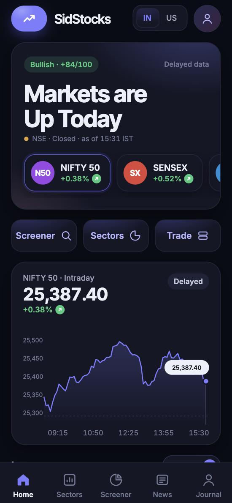
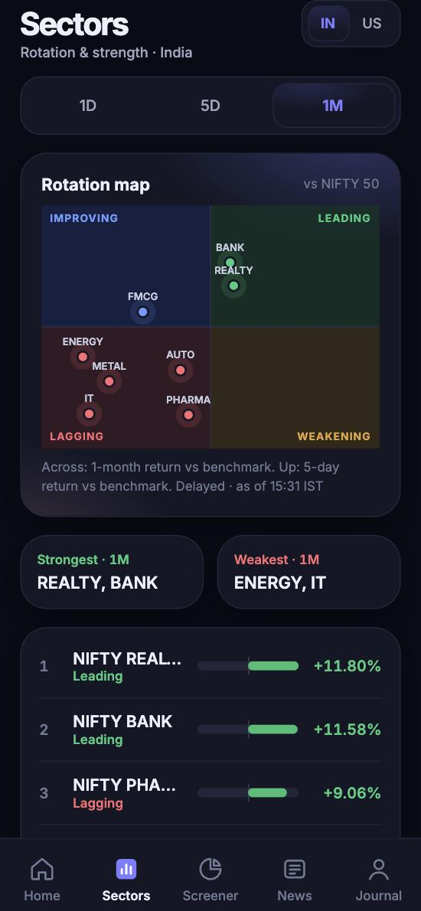
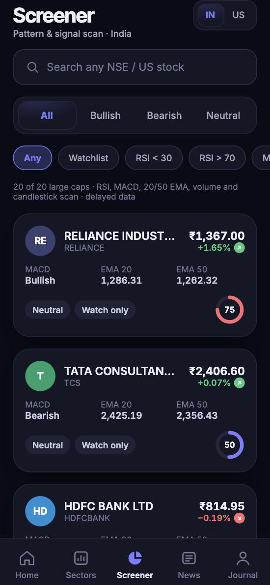
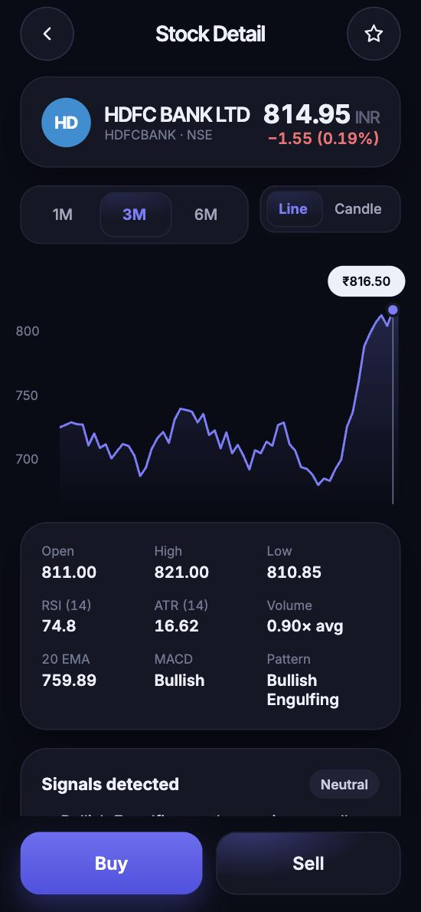
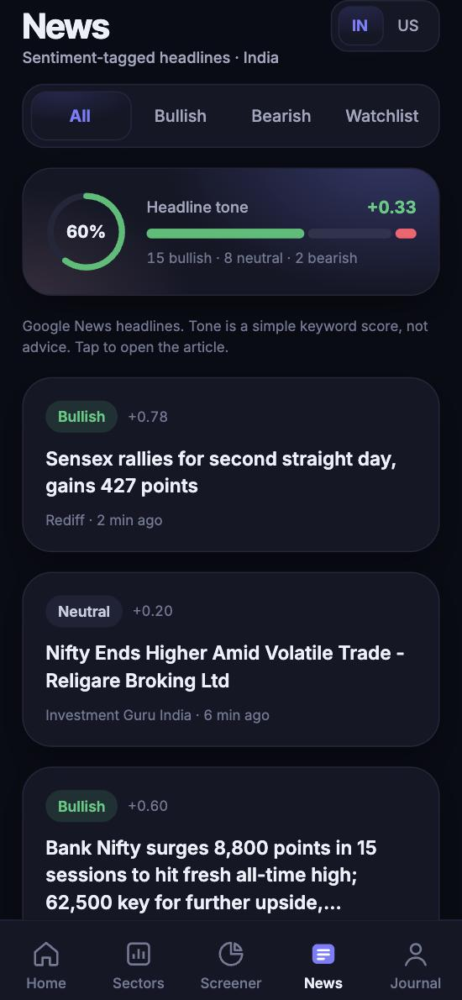
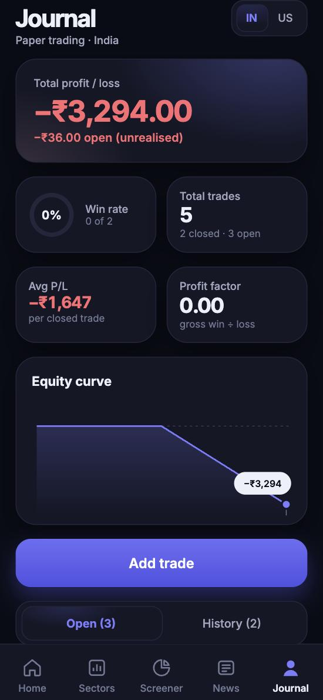
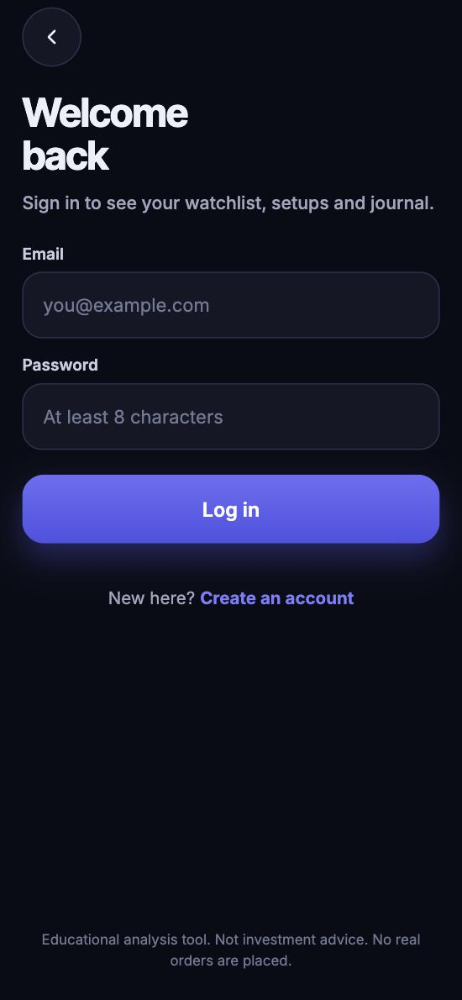

# SidStocks

Stock market analysis and paper-trading app for the **Indian (NSE/BSE)** and **US** markets.
Track the market, scan stocks with technical indicators, spot candlestick patterns, read sentiment-tagged news and keep a paper-trading journal.

## Try it

| | Link |
|---|---|
| 🌐 **Web app** (any browser: Mac, Windows, iPhone, Android) | https://sidstocks.vercel.app |
| 🤖 **Android APK** | [Download APK](https://expo.dev/artifacts/eas/3i8LX0pYMtkWgOfRqH47cCe5nug-Sn29g5oxk9vWP2M.apk) |
| ⚙️ Backend API | https://sidstocks-backend.vercel.app/health |

Log in or create an account to use the app. The Android app updates itself over the air; reinstalling is only needed for native changes.

> The APK link is hosted on Expo and expires after some time. A fresh one can be built with `eas build -p android --profile preview` (see below).

## Screenshots

| Home | Sectors | Screener | Stock detail |
|:---:|:---:|:---:|:---:|
|  |  |  |  |

| News | Journal | Welcome | Log in |
|:---:|:---:|:---:|:---:|
|  |  |  |  |

## Features

- **Home** – India / US switch, NIFTY 50, SENSEX, BANK NIFTY, S&P 500, NASDAQ, DOW JONES, intraday chart, market status, market breadth, top gainers and losers, and an overall sentiment score.
- **Sectors** – sector performance for 1 day, 5 days and 1 month, a rotation map (Leading, Improving, Weakening, Lagging) and a ranked list.
- **Screener** – scans large caps with RSI, MACD, EMA 20/50 and volume. Filters for bullish, bearish and neutral bias, oversold / overbought RSI, MACD crosses, EMA trend, volume spikes and candlestick patterns. Search any NSE or US stock.
- **Stock detail** – line and candlestick charts (1M / 3M / 6M) with the 20 EMA, indicator grid, detected signals, and an educational trade setup with entry zone, stop-loss and two targets.
- **Pattern recognition** – Bullish / Bearish Engulfing, Hammer, Shooting Star, Doji, Morning / Evening Star, Golden / Death Cross and MACD crossovers.
- **News** – latest Indian and US market headlines from Google News with Bullish / Bearish / Neutral tone and a link to the original article.
- **Journal** – paper orders from any stock, manual trade entry with notes, open positions with live P/L, history, win rate, profit factor and an equity curve. Saved per user in Supabase.
- **Theme** – Dark (default), Light or follow the phone setting.
- Market data refreshes every minute while the app is open.

## Tech stack

| Part | Tools |
|---|---|
| Mobile + web app | React Native, Expo, Expo Router, TypeScript, react-native-svg |
| Backend | Node.js, Express, TypeScript |
| Database and login | Supabase (PostgreSQL + Auth, row-level security) |
| Market data | Yahoo Finance (`yahoo-finance2`), delayed |
| News | Google News RSS |
| Hosting | Vercel (web + backend), Expo EAS (Android build and updates) |

All indicators (RSI, MACD, EMA, ATR, volume) and candlestick patterns are written in plain TypeScript in `backend/src/indicators.ts`.

## Project structure

```
SidStocks/
├── mobile/            Expo app (Android, iOS, web)
│   └── src/
│       ├── app/       screens (tabs, stock detail, welcome, login)
│       ├── components/ reusable UI (cards, charts, buttons, order sheet)
│       ├── context/   theme, login and app state
│       ├── lib/       API helper and Supabase client
│       └── constants/ design tokens
├── backend/           Express API
│   ├── src/           server, market data, indicators, news, routes
│   ├── api/           Vercel entry
│   └── schema.sql     database tables and security rules
└── design/            approved prototype and design handoff
```

## Run locally

**Requirements:** Node.js 22+, a free Supabase project.

1. **Database** – in Supabase, open the SQL Editor and run `backend/schema.sql`.
2. **Keys** – copy the example env files and fill in your Supabase project URL and **publishable (anon) key**:
   ```bash
   cp backend/.env.example backend/.env
   cp mobile/.env.example mobile/.env
   ```
   Never use the Supabase secret / service-role key; the project does not need it.
3. **Backend**
   ```bash
   cd backend
   npm install
   npm run dev        # http://localhost:4000/health
   ```
4. **App**
   ```bash
   cd mobile
   npm install
   npx expo start     # scan the QR with Expo Go, or press w for the browser
   ```
   On a phone, keep it on the same Wi-Fi as the computer; the app finds the local backend automatically.

## API

Public (no login):

| Endpoint | Returns |
|---|---|
| `GET /health` | server status |
| `GET /market/overview?market=IN` | indices, intraday chart, breadth, movers, sentiment, summary |
| `GET /market/sectors?market=IN` | sector returns and rotation |
| `GET /market/screener?market=IN` | indicators, pattern and bias for each large cap |
| `GET /market/stock/:symbol` | full analysis of one stock (e.g. `RELIANCE.NS`, `AAPL`) |
| `GET /market/search?q=tata` | stock search |
| `GET /market/news?market=IN` | headlines with sentiment |

Logged in (`Authorization: Bearer <Supabase access token>`):

| Endpoint | Does |
|---|---|
| `GET /api/me` | current user |
| `GET / POST / DELETE /api/watchlist` | read, add, remove watchlist stocks |
| `GET /api/trades?market=IN` | paper trades |
| `POST /api/trades` | open a paper position, or save a finished trade (with `exit`) |
| `POST /api/trades/:id/close` | close a position at an exit price |

Market data is cached on the server for 5 minutes. If Yahoo fails, the last good data is returned and marked as stale.

## Deploy

```bash
# website (from mobile/)
npm run deploy:web

# backend (from backend/)
npx vercel deploy --prod

# push app changes to installed Android apps, no new APK needed (from mobile/)
npm run update:app -- "what changed"

# new Android APK (from mobile/)
npx eas-cli build -p android --profile preview
```

The backend on Vercel needs `SUPABASE_URL` and `SUPABASE_ANON_KEY` set as environment variables.

## Disclaimer

Market data is delayed and may be incomplete. Trade setups and sentiment labels are algorithmic and for **educational use only**; they are not financial advice. The journal is **paper trading only**: no real orders are sent to any broker.
